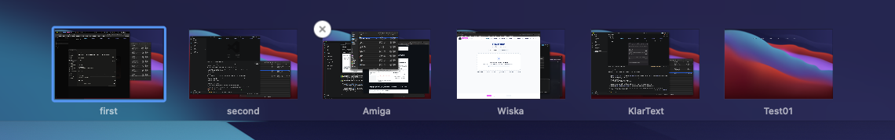
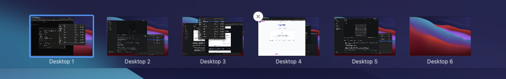
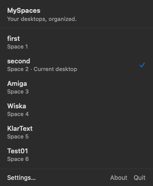
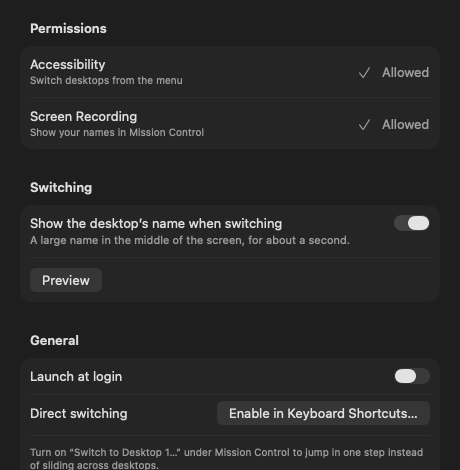

# MySpaces

Give your Mac's desktops real names, and see them where you need them: in Mission Control, in the
menu bar, and in the middle of the screen each time you switch.

macOS calls every desktop "Desktop 1", "Desktop 2"… and offers no way to rename them. MySpaces is a
small menu-bar app that fixes that without patching the system: SIP stays on and nothing is injected
into the Dock.



## Features

- **Name your desktops** from the menu bar. Names follow their desktops when you reorder them, and
  survive logouts and restarts.
- **Names in Mission Control.** Your names are drawn over macOS's own labels, in the same font and
  colour, both in the top bar and under the thumbnails when it expands. They keep up with Mission
  Control's animations and with desktops being added or removed.
- **Name when switching.** After you switch desktops, the new desktop's name shows large in a
  translucent panel in the middle of the screen for about a second. It can be turned off in Settings.
- **Switch from the menu.** Click a desktop in the menu to go there.
- **Long names fade out** at the end instead of being cut off with "…".
- **Launch at login**, and nothing else to set up.

| Mission Control, before | Mission Control, with MySpaces |
| --- | --- |
|  |  |


| The menu | Switching | Settings |
| --- | --- | --- |
|  |  |  |

## Requirements

- macOS 27 or later
- One display. Desktops on additional displays are not supported yet.

## Install

### From a release

1. Download `MySpaces-<version>.zip` from the project's Releases page and unzip it.
2. Move `MySpaces.app` to `/Applications` and open it. The icon appears in the menu bar.
3. Allow the two permissions it asks for (see below).

Release builds are signed with a Developer ID and notarized, so they open without Gatekeeper warnings.

### From source

Requires Xcode 27 (Swift 6.4).

```sh
git clone <this repository>
cd MySpaces
scripts/build-app.sh          # builds build/MySpaces.app (optimised)
open build/MySpaces.app
```

`build-app.sh` signs with your "Apple Development" certificate, so permissions you grant survive
rebuilds. Set `MYSPACES_SIGN_IDENTITY` to use a different identity.

If the menu-bar icon is hidden on a crowded menu bar, hold ⌘ and drag it into view.

### Permissions

| Permission | Used for |
| --- | --- |
| Accessibility | Switching desktops from the menu: MySpaces presses your Mission Control keyboard shortcuts for you. |
| Screen Recording | Finding macOS's desktop labels on screen so your names can be placed over them. Nothing is saved or sent anywhere. |

Both are optional: without Accessibility you can still name desktops; without Screen Recording the
names show everywhere except Mission Control.

For instant switching to any desktop, turn on **Switch to Desktop 1…** under System Settings ›
Keyboard › Keyboard Shortcuts › Mission Control. Without it, MySpaces steps across desktops one at a
time.

## How it works

macOS has no public API for naming desktops, and Mission Control's labels can't be changed. So
MySpaces works alongside the system:

1. **Reading desktops.** It reads the list of desktops (and which one is current) from the window
   server, read-only. Each desktop has a stable ID, so a name stays with its desktop when desktops
   are reordered. Names are stored in `~/Library/Application Support/MySpaces/names.json`.
2. **Finding the labels.** When Mission Control opens, MySpaces captures the strip of the screen
   where the Spaces bar is drawn and reads macOS's "Desktop N" labels with on-device text
   recognition (Vision), so it knows exactly where each label is.
3. **Drawing the names.** It draws each name in its own small, click-through window just above
   Mission Control. The patch behind a name is rebuilt from the pixels beside the label, row by row,
   so the background (gradients, the current desktop's highlight) shows through. Where the background
   is too busy, a solid pill is used instead.
4. **Keeping up.** While Mission Control is open, a live screen stream is checked up to 60 times a
   second against a small fingerprint of the labels' pixels. That decides in a frame or two when
   names should appear, follow a moving row, or hide, and remembers each layout so the next time is
   instant. Layouts are cached in `~/Library/Application Support/MySpaces/layouts-v4.json`; deleting
   it is safe.
5. **Switching.** Switching from the menu sends the same keyboard shortcuts you would press. The
   name panel appears when macOS reports that the current desktop changed.

## Development

```sh
swift test                    # unit tests for the logic in Sources/MySpacesCore
scripts/build-app.sh          # app bundle in build/
scripts/release.sh            # Developer ID build, notarized zip (needs a notarytool profile)
```

- `Sources/MySpacesCore`: tested logic (desktop list, names, label recognition and mapping,
  fingerprints, layout handling).
- `Sources/MySpaces`: the app (menu bar, Mission Control overlay, switch panel, settings).
- `docs/release-checklist.md`: manual checks to run before a release and after macOS updates.

## Known limitations

- One display only.
- Tested with English macOS labels ("Desktop N").
- The first time a Mission Control layout appears, it takes about half a second to learn; after that
  it is remembered.

## License

MIT. See [LICENSE](LICENSE).
